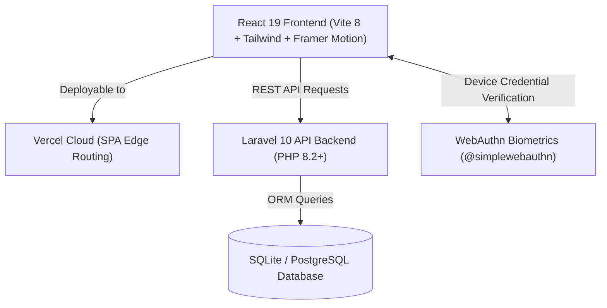

# V-Finance (Project V Finance)

<p align="center">
  
</p>

<h3 align="center">Personal, Student & Commercial Financial Intelligence Platform</h3>

<p align="center">
  A modern, full-stack fintech platform designed for personal finance tracking, student budgeting, and commercial cash-flow reconciliation. Built with <b>React 19</b>, <b>Framer Motion</b>, <b>Tailwind CSS</b>, and a robust <b>Laravel API</b> backend.
</p>

<p align="center">
  <a href="https://github.com/Prashwinachya/V-Finance/stargazers"></a>
  <a href="https://github.com/Prashwinachya/V-Finance/network/members"></a>
  <a href="https://github.com/Prashwinachya/V-Finance/issues"></a>
  <a href="https://vercel.com"></a>
</p>

---

## 🌟 Key Highlights

### 1. Dual-Persona Architecture
* **🎓 Student Portal**: Streamlined budgeting envelopes, campus expense tracking, tuition and stipend logging, and flexible manual inputs with optional bank synchronization.
* **💼 Business Portal**: High-velocity commercial ledger, enterprise revenue tracking, invoice reconciliation, and automated bank feed integrations.

### 2. Next-Gen Animated UI/UX
* **Emergent-Grade Interface**: Signature pink-to-purple gradient aesthetic, glassmorphic cards (`backdrop-blur`), and responsive two-column layouts.
* **Framer Motion Micro-Interactions**: Dynamic layout springs (`layoutId`), interactive persona switches, SVG velocity sparklines, and password visibility reveals.
* **Live Financial Simulation**: Real-time velocity forecasting and simulated verified transaction floaters directly on login.

### 3. Financial Control Center (10-Module Settings Suite)
* **Profile & Identity**: Real-time profile completion scoring, avatar upload, and metadata management.
* **Advanced Security**: Hardware-backed **WebAuthn Biometric passkeys** (Fingerprint/TouchID), 4-digit Transaction PIN, active session revocation, and instant emergency lockout.
* **Safety Autopilot**: Algorithmic financial health scoring (0–100) with rule-based safety directives.
* **Emergency Money Mode**: Essential vs. non-essential expense categorization, safe-to-spend allowances, and subscription pause checklist.
* **Financial Alerts**: Granular threshold triggers for large transfers, daily limits, and abnormal spend alerts.
* **Privacy & Telemetry**: Balance privacy mask, telemetry controls, and one-click JSON data export.
* **Card & Payment Controls**: Daily allowances, single-swipe caps, contactless NFC, and international transaction toggles.
* **Investment Profile**: Risk tolerance preferences (Conservative, Moderate, Aggressive) and dividend reinvestment options.
* **Personalization**: Currency selection (`INR`, `USD`, `EUR`, `GBP`), density spacing, and default landing views.
* **Activity Audit Log**: Full timestamped immutable trail of security events, login attempts, and card states.

---

## 🏗️ Architecture & Tech Stack



### Technology Breakdown
* **Frontend**: React 19, Vite 8, Framer Motion, Tailwind CSS, Lucide React, Recharts, Axios.
* **Backend**: Laravel 10 (PHP 8.2+), Eloquent ORM.
* **Database**: SQLite (local with automated snapshots) or PostgreSQL.
* **Security & Auth**: Laravel Sanctum tokens, WebAuthn Passkey API (`@simplewebauthn/browser`), 4-Digit payment PIN hash verification.

---

## 📁 Repository Structure

```plaintext
Project_V_Finance/
├── app/                        # Laravel Controllers, Models & Services
│   ├── Http/Controllers/Api/   # API endpoints (Auth, Wallets, Settings, Pulse)
│   ├── Models/                 # Eloquent entities (User, Setting, AuditLog)
│   └── Services/               # Business logic (Bank sync, Subscription radar)
├── database/                   # Database migrations & seeds
│   └── migrations/             # Schema definitions (Users, Settings, Logs)
├── routes/
│   └── api.php                 # Protected API endpoints
├── vfinance/
│   └── client/                 # React 19 Frontend
│       ├── src/
│       │   ├── api/            # Axios API client & baseURL configuration
│       │   ├── components/     # Reusable UI & settings modules
│       │   │   └── settings/   # 10 Financial Control Center subcomponents
│       │   ├── context/        # Auth & Role context providers
│       │   ├── pages/          # Full-page views (Dashboard, Login, Settings)
│       │   └── utils/          # Formatting & WebAuthn biometric helpers
│       ├── package.json        # Client dependencies (Framer Motion, Lucide)
│       ├── vite.config.js      # Dual-build target (dist/ + public/vfinance/)
│       └── vercel.json         # Client SPA rewrites
├── public/                     # Laravel public root & compiled SPA assets
├── vercel.json                 # Root deployment configuration for Vercel
└── package.json                # Root automation scripts
```

---

## 🚀 Quick Start & Development

### Prerequisites
* **Node.js** (v18 or higher)
* **PHP** (8.1 or higher) & **Composer**

### 1. Clone the Repository
```bash
git clone https://github.com/Prashwinachya/V-Finance.git
cd V-Finance
```

### 2. Install Dependencies
```bash
# Install PHP dependencies
composer install

# Install client packages
npm --prefix vfinance/client install
```

### 3. Environment & Database Setup
```bash
cp .env.example .env
php artisan key:generate

# Run database migrations
touch database/database.sqlite
php artisan migrate
```

### 4. Start Development Servers

**Option A: Standalone Vite Frontend (with API proxy to 8000)**
```bash
npm --prefix vfinance/client run dev
```
*Frontend runs at `http://localhost:5174`*

**Option B: Full-Stack with Laravel API Backend**
```bash
# Terminal 1: Backend API
php artisan serve --port=8000

# Terminal 2: Frontend Client
npm --prefix vfinance/client run dev
```

---

## 🌐 Deploying to Vercel

V-Finance is pre-configured for one-click deployment on **Vercel**:

1. Push your repository to GitHub.
2. In the [Vercel Dashboard](https://vercel.com/new), click **Add New Project** and select `V-Finance`.
3. Configure the Project:
   * **Framework Preset**: `Vite`
   * **Root Directory**: `vfinance/client` *(or leave blank for root with automated `vercel.json` routing)*
   * **Build Command**: `npm run build`
   * **Output Directory**: `dist`
4. Add Environment Variables (optional, for connecting external backend):
   * `VITE_API_URL`: Your hosted Laravel API URL (e.g., `https://api.yourdomain.com/api`)
5. Click **Deploy**.

---

## 🔒 Data Protection & Backups

To ensure data integrity, the local SQLite database uses automated safety snapshots:

```bash
# Create a manual database snapshot
php artisan data:backup

# Restore from latest backup
php artisan data:restore --latest

# Restore from a specific timestamped backup
php artisan data:restore storage/app/backups/database/database_YYYYMMDD_HHMMSS.sqlite
```

---

## 👤 Author & Credits

* **Developer**: Prashwin Prabhakar ([@Prashwinachya](https://github.com/Prashwinachya))
* **Repository**: [https://github.com/Prashwinachya/V-Finance](https://github.com/Prashwinachya/V-Finance)

---

## 📄 License
This project is open-source under the [MIT License](LICENSE).
